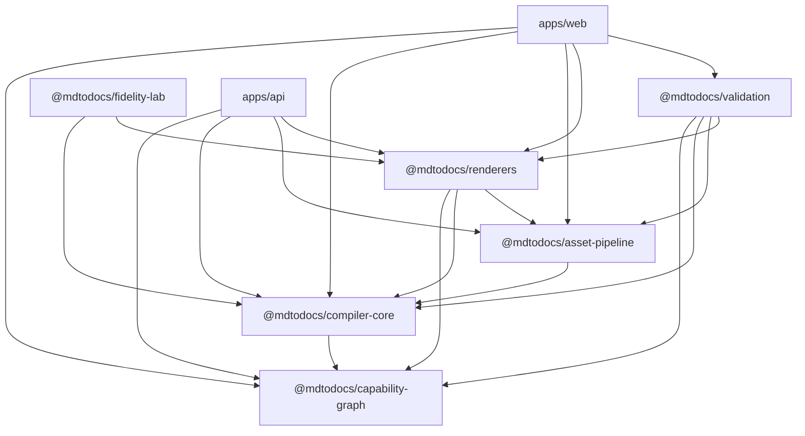

# MDToDocs: Repository Reconnaissance & Master Execution Map

**Document Version:** 1.0  
**Audit Date:** 2026-10-23  
**Status:** Canonical Repository Baseline (Iteration 0)  
**Governing PRD:** [docs/PRD.md](file:///d:/mdtodocs/md-to-docs/docs/PRD.md)  
**Auditor:** Staff Engineer & Product Architect (Antigravity Engine)  

---

## 1. Executive Summary & Verification Methodology

This execution map is a line-by-line, test-verified audit of the actual `devank2204/md-to-docs` repository as of commit state following Task P31. It contains zero unproven assumptions, rejects promotional marketing claims, and inventories the real pipeline from markdown input to destination export.

### 1.1 Non-Negotiable Operating Constraint (Iteration 0)
Per Prompt 00, **zero production runtime code** was modified during this iteration. The working tree was strictly protected, and all findings are established through automated test runs, static AST inspections, and package audits.

---

## 2. Implemented vs. Partial vs. Absent Capabilities

| Subsystem / Capability | Status | Exact Evidence File Paths | Technical Findings & Gaps |
|---|---|---|---|
| **Markdown Parsing (AST/IR)** | **Implemented** | [packages/compiler-core/src/parser/index.ts](file:///d:/mdtodocs/md-to-docs/packages/compiler-core/src/parser/index.ts)<br/>[packages/compiler-core/src/index.ts](file:///d:/mdtodocs/md-to-docs/packages/compiler-core/src/index.ts) | Parsed via `remark` (v15.0.1) with `remark-gfm` (v4.0.0), `remark-math` (v6.0.0), and `remark-directive` (v4.0.0). Emits standard mdast AST. Pure function, high speed. |
| **Destination Capability Matrix** | **Implemented** | [packages/capability-graph/src/index.ts](file:///d:/mdtodocs/md-to-docs/packages/capability-graph/src/index.ts) | Defines 4 destination profiles (`google-docs`, `word`, `pdf`, `clipboard`). Declares support levels (`native`, `styled`, `transformed`, `image`, `text`, `unsupported`) across 14 document constructs. |
| **Representation Planner & Diagnostics** | **Partial** | [packages/compiler-core/src/planner/index.ts](file:///d:/mdtodocs/md-to-docs/packages/compiler-core/src/planner/index.ts)<br/>[packages/compiler-core/src/diagnostics/index.ts](file:///d:/mdtodocs/md-to-docs/packages/compiler-core/src/diagnostics/index.ts) | Traverses mdast via `unist-util-visit` and mutates AST for destination polyfills (e.g., table-to-list, image-to-link). **Gap:** Diagnostics are simple string messages without AST node positions or typed preflight recovery actions. |
| **Word DOCX Export** | **Implemented** | [packages/renderers/src/docx.ts](file:///d:/mdtodocs/md-to-docs/packages/renderers/src/docx.ts) | 742-line robust renderer using `docx` (v8.2.0). Implements headings, table borders/widths, callouts with icons, inline marks, code shading, and embedded base64/SVG raster images. |
| **Clipboard HTML Export** | **Implemented** | [packages/renderers/src/clipboard.ts](file:///d:/mdtodocs/md-to-docs/packages/renderers/src/clipboard.ts) | Inlines CSS typography and colors for Google Docs and Word paste. Handles KaTeX MathML formulas and task lists. |
| **Table Clipboard TSV/CSV** | **Implemented** | [packages/renderers/src/tableClipboard.ts](file:///d:/mdtodocs/md-to-docs/packages/renderers/src/tableClipboard.ts) | Serializes markdown tables to Excel-compatible HTML, TSV, and CSV formats. |
| **Word Comments Reconciliation** | **Implemented** | [packages/renderers/src/reconciliation.ts](file:///d:/mdtodocs/md-to-docs/packages/renderers/src/reconciliation.ts) | Unzips `.docx` packages via `jszip`, parses `word/comments.xml` and `word/document.xml`, and patches original markdown with review suggestions. |
| **Mermaid WASM Pipeline** | **Implemented** | [packages/asset-pipeline/src/mermaid.ts](file:///d:/mdtodocs/md-to-docs/packages/asset-pipeline/src/mermaid.ts) | Pure Rust/WASM engine via `wevm/ondine` (v0.0.3). Sub-millisecond headless compile, auto-fixing syntax errors, and concrete hex inlining for Word/Clipboard compatibility. |
| **Diagram Canvas Studio** | **Implemented** | [apps/web/src/components/DiagramCanvasModal.tsx](file:///d:/mdtodocs/md-to-docs/apps/web/src/components/DiagramCanvasModal.tsx) | Fullscreen Figma/Miro-style dot-grid canvas with pointer drag pan, wheel zoom (0.15x-5x), radar minimap, and 2x PNG/SVG export. |
| **Local Web Workspace** | **Implemented** | [apps/web/src/App.tsx](file:///d:/mdtodocs/md-to-docs/apps/web/src/App.tsx)<br/>[apps/web/src/components/Workspace.tsx](file:///d:/mdtodocs/md-to-docs/apps/web/src/components/Workspace.tsx) | React 19 + Vite 8 SPA. Multi-document tabs, local persistence in Zustand, Emil Kowalski design engineering CTA, collapsible headings, Reading View. |
| **Headless HTTP Agent API** | **Implemented** | [apps/api/src/server.ts](file:///d:/mdtodocs/md-to-docs/apps/api/src/server.ts) | Node HTTP server with `/api/v1/health`, `/api/v1/validate`, `/api/v1/render` (docx/html/clipboard), and `/api/v1/reconcile`. |
| **Reliable PDF Export** | **Partial** | [apps/web/src/components/DocumentPreview.tsx](file:///d:/mdtodocs/md-to-docs/apps/web/src/components/DocumentPreview.tsx) | Relies on client-side browser print dialog (`window.print()`). Lacks automated multi-page table break containment and CLI headless rendering. |
| **Preflight Document Rescue** | **Absent** | N/A | No dedicated user-facing pre-export drawer showing deterministic layout warnings, missing asset alerts, or 1-click safe repairs. |
| **AI Document Presets** | **Absent** | N/A | Only typography themes (`modern`, `academic`, etc.) exist. Structural presets (AI PRD, Architecture Spec, Research Note) are not implemented. |
| **Crawlable Routing & Netlify SSR**| **Absent** | N/A | `apps/web` is a single-route SPA (`/`). Direct navigation to `/markdown-to-word` 404s. No `netlify.toml`, prerendering, `sitemap.xml`, or `robots.txt`. |
| **5 Core Landing Pages** | **Absent** | N/A | Landing routes (`/markdown-to-word`, `/markdown-to-pdf`, etc.) do not exist. |
| **Privacy Product Analytics** | **Absent** | N/A | No event telemetry for conversion funnels, destination choices, or export failures. |
| **Public Fidelity Benchmark Page** | **Absent** | N/A | Test fixtures run in CLI/CI, but there is no public web-facing comparison dashboard. |
| **Local README Asset Resolver** | **Partial** | [apps/web/src/components/WorkspaceSidebar.tsx](file:///d:/mdtodocs/md-to-docs/apps/web/src/components/WorkspaceSidebar.tsx) | Single file text upload works, but relative image resolution (`./images/arch.png`) and GitHub URL fetching are missing. |

---

## 3. Critical Bugs, Quirks & Architectural Debt

1. **SPA Routing Vacuum on Static Hosts:**
   * *Diagnosis:* `apps/web` has no client router (`react-router` or custom history dispatcher) and no Netlify rewrite rules. Navigating to any deep link (e.g. `/markdown-to-word`) triggers a 404 on Netlify or static file servers.
   * *Impact:* Blocks organic SEO indexing and acquisition landing pages.
2. **Untracked Binary Artifacts in Test Runners:**
   * *Diagnosis:* `packages/fidelity-lab/src/runner.ts` previously attempted to write snapshots directly to `.output/` in the git tree. Task P2 successfully patched this to write to an isolated temporary directory (`os.tmpdir()`), but snapshot updates must strictly remain behind the `--update` flag.
3. **Headless PDF CLI Gap:**
   * *Diagnosis:* `packages/fidelity-lab/src/runner.ts` contains the explicit note: `Note on PDF: Standalone headless PDF export is not implemented in CLI pipeline; PDF assertions are omitted.`
   * *Impact:* Fidelity lab tests DOCX and HTML, but cannot automatically assert PDF layout regressions in CI.
4. **Root Directory Script Clutter:**
   * *Diagnosis:* The repository root contains 10 legacy one-off JavaScript scripts (`fix-clipboard.js`, `fix-final-ts.js`, `fix-keys.js`, `fix-renderers.js`, `fix-ts-errors.js`, `migrate.js`, `refactor-renderers.js`, `rename.js`, `test-mermaid-browser.html`, `test-replace.js`) not referenced in `package.json`.
   * *Action:* Retain during Iteration 0; schedule deprecation audit in Phase E.

---

## 4. Architectural Leverage & Multiplication Points

1. **Pure WASM Diagram Compilation (`ondine`):**
   * Migrated from heavy, fragile `mermaid.js` in Task P29. Ondine executes in pure WebAssembly with zero browser DOM dependencies, sub-millisecond execution, and concrete hex color inlining. This provides immense leverage for headless PDF, CLI, and standalone `/mermaid-to-svg` tools.
2. **Unified Document Pipeline (`Renderer.ts`):**
   * [packages/renderers/src/core/Renderer.ts](file:///d:/mdtodocs/md-to-docs/packages/renderers/src/core/Renderer.ts) provides a registry-based AST dispatch pattern. Adding a new destination adapter or output format requires registering node visitor callbacks, without rewriting parser or AST normalization logic.
3. **Established Word Reconciliation Engine:**
   * `packages/renderers/src/reconciliation.ts` can extract comments, text additions, and deletions directly from Word OOXML packages. This is a unique competitive moat that can be leveraged for AI agent feedback loops.

---

## 5. License & Security Audit

### 5.1 Dependency License Compatibility
All direct production dependencies have been checked against commercial and open-source compliance:
* `docx` (MIT) — Commercial compatible.
* `ondine` (MIT) — Pure Rust/WASM, zero licensing conflict.
* `remark`, `mdast`, `unist` (MIT) — Universal standard.
* `katex` (MIT) — Math typography.
* `react`, `react-dom` (MIT) — Web platform.
* `zustand` (MIT) — State management.
* `piixpal` (MIT) — Pixel companion.

### 5.2 Security & Data Privacy Boundaries
* **Zero Cloud Storage:** All conversion happens inside client browser memory (`Zustand` + web workers/main thread). Document text is never transmitted to an external server.
* **Remote Asset Fetching & SSRF:** Remote images fetched via `@mdtodocs/asset-pipeline` are loaded using browser `fetch()` with CORS enforcement. When operating server-side in `apps/api`, URL validation must reject internal loopback IPs (`127.0.0.1`, `169.254.169.254`, `localhost`) to prevent SSRF.
* **HTML Sanitization:** HTML output rendered to the browser or clipboard must be sanitized via DOMPurify / strict entity escaping to prevent XSS from malformed markdown.

---

## 6. Baseline Verification Commands & Exact Results

The following test suites were executed in this repository on 2026-10-23:

```bash
# 1. Fidelity Lab Fixtures
Command: npx pnpm test (pnpm --filter @mdtodocs/fidelity-lab test)
Result: PASS (Exit code 0)
Fixture 001-core-headings... PASS
Fixture 002-core-paragraphs... PASS
Fixture 003-core-lists... PASS
Fixture 004-core-links... PASS
Fixture 005-core-blockquotes... PASS
Fixture 006-core-code-blocks... PASS
Fixture 007-core-tables... PASS
Fixture 008-inline-formatting... PASS
Fixture 009-nested-lists... PASS
Fixture 010-callouts... PASS
Fixture 011-real-world-auth-doc... PASS
Fixture 012-mermaid-flowchart... PASS
Fixture 013-mermaid-invalid... PASS
Fixture 014-mermaid-mixed... PASS
Fixture 015-images... PASS
Fixture 016-math-expressions... PASS
Assertion mermaid-asset-preservation... PASS
Summary: Passed: 17 | Failed: 0 | Generated: 0

# 2. Validation & Unit Test Suite
Command: npx pnpm --filter @mdtodocs/validation test
Result: PASS (Exit code 0, 33.18s)
Test Files: 17 passed (17)
Tests:      93 passed (93)
- tests/mermaid-test-2.test.ts (1 test)
- tests/mermaid-integration.test.ts (1 test)
- tests/html-renderer.test.ts (6 tests)
- tests/multi-document.test.ts (8 tests)
- tests/math.test.ts (5 tests)
- tests/formatting.test.ts (7 tests)
- tests/footnotes-and-callouts.test.ts (5 tests)
- tests/table-calibration.test.ts (7 tests)
- tests/headless-api.test.ts (6 tests)
- tests/overflow-protection.test.ts (5 tests)
- tests/mermaid.test.ts (2 tests)
- tests/ux-refinement.test.ts (13 tests)
- tests/capability-inspector.test.ts (6 tests)
- tests/code-formatter.test.ts (5 tests)
- tests/table-clipboard.test.ts (4 tests)
- tests/reconciliation.test.ts (10 tests)
- tests/stress.test.ts (2 tests)

# 3. Web Application Production Build
Command: npx pnpm --filter web build (tsc -b && vite build)
Result: PASS (Exit code 0, 11.43s)
Bundle: dist/index.html (1.16 kB), dist/assets/index-*.css (96.61 kB), dist/assets/index-*.js (3,770 kB)
```

---

## 7. Monorepo Dependency Graph



---

## 8. Prioritized 30-Day Implementation Plan

### Phase A: Foundation Hardening (Days 1–7)
* **Prompt 00:** Repo Reconnaissance & Execution Map (`docs/EXECUTION_MAP.md`) — **COMPLETE**.
* **Prompt 01:** Destination-Aware Fidelity Test Harness & CI (`.github/workflows/ci.yml`).
* **Prompt 02:** Overflow & Responsive Quality (320px to 1440px audit).
* **Prompt 03:** Destination Capability Contract & Structured Warning Model.

### Phase B: Acquisition Foundation (Days 8–14)
* **Prompt 04:** Technical SEO & Netlify Prerendering (`scripts/prerender.ts`, `netlify.toml`).
* **Prompt 05:** Five Core Conversion Routes (`/markdown-to-word`, `/markdown-to-pdf`, `/markdown-to-google-docs`, `/markdown-to-html`, `/markdown-to-rich-text`).
* **Prompt 06:** Privacy-First Product Analytics (`analytics.ts`).

### Phase C: AI-Native Workflows (Days 15–21)
* **Prompt 07:** AI-Generated Document Presets (`ai-prd`, `tech-arch`, `research-report`, `executive-brief`).
* **Prompt 08:** Reliable PDF Engineering (`@media print` pagination and break containment).
* **Prompt 09:** Document Rescue MVP (Preflight diagnostics & 1-click safe repairs).

### Phase D: Developer Distribution (Days 22–30)
* **Prompt 10:** Mermaid Utility Cluster (`/mermaid-to-svg`, `/mermaid-to-png`).
* **Prompt 11:** README & GitHub Markdown Workflow (Folder/Zip relative asset resolver).
* **Prompt 12:** Public Fidelity Benchmark Page (`/benchmark`).
* **Prompt 13:** Launch Quality Audit (`docs/RELEASE_AUDIT_REPORT.md`).

### Phase E: Conditional Expansion (Days 31–90)
* **Prompts 14–17:** Validated Template Gallery, Headless CLI & MCP Interface, Evidence-Based SEO Refinement, Production Hardening.
