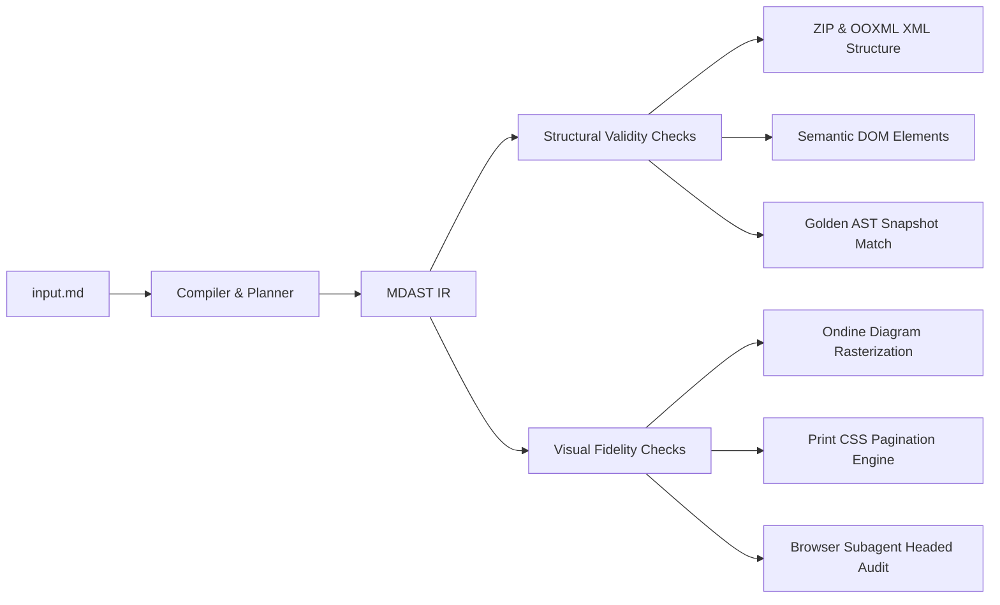

# MDToDocs: Fidelity Regression System & Test Methodology

**Document Version:** 1.0  
**Status:** Canonical Engineering Specification  
**Governing Prompt:** Prompt 01 (Phase A: Foundation Hardening)  

---

## 1. Overview & Dual-Verification Architecture

MDToDocs tests fidelity across two distinct, complementary vectors:
1. **Structural Validity:** Deterministic, machine-verifiable assertions verifying AST transformations, Office Open XML (OOXML) markup integrity, ZIP package structures, and semantic HTML elements.
2. **Visual Fidelity:** Real-render inspections asserting layout pagination, table column wrapping, CSS print rules, and diagram rasterization without browser clipping.



---

## 2. Structural Validity vs. Visual Fidelity Matrix

| Verification Tier | Test Suite / Tool | What It Proves | What It Does NOT Prove |
|---|---|---|---|
| **Structural Validity** | `packages/fidelity-lab`<br/>(`runner.ts`) | • AST matches golden `expected-ir.json`<br/>• DOCX is valid PKZIP archive with `[Content_Types].xml`<br/>• `word/document.xml` contains `<w:tbl>`, `<w:numPr>`, `<w:drawing>`<br/>• Clipboard HTML contains valid semantic tags (`<h1>`, `<table>`, `<math>`)<br/>• Multilingual UTF-8 characters and smart quotes are preserved | Does NOT prove that desktop Word or Google Docs will render with exact pixel typography or font kerning. |
| **Compiler Unit Tests** | `packages/validation`<br/>(`vitest run`) | • Node renderer isolation (`html.ts`, `docx.ts`, `clipboard.ts`)<br/>• Word comment extraction and track-changes reconciliation<br/>• KaTeX formula parsing and MathML generation<br/>• Ondine Mermaid WASM syntax parsing and error recovery<br/>• Code formatting and table clipboard TSV/CSV serialization | Does NOT prove end-to-end browser viewport styling. |
| **Visual Fidelity** | Browser Subagent / Headed Browser | • Page-level horizontal overflow (`window.scrollX === 0`)<br/>• Responsive layout at 320px, 375px, 768px, 1280px, 1440px<br/>• Diagram Canvas Studio pan, zoom, and radar minimap<br/>• Collapsible headings expand and collapse smoothly<br/>• LoadingButton checkmark and specular reflection render crisply | Does NOT prove binary XML validity of exported files. |
| **Print Pagination** | `@media print` CSS Engine | • `@page` margins and page break containment<br/>• `break-inside: avoid` on tables, code blocks, and diagrams<br/>• Running headers and page number counters (`counter(page)`) | Subject to individual browser print rendering engine variations. |

---

## 3. Curated Golden Fixture Corpus (20 Fixtures)

All fixtures live in `packages/fidelity-lab/fixtures/` and are automatically executed by `pnpm test`:

| ID | Fixture Directory | Construct Tested | Key Structural Assertions |
|---|---|---|---|
| `001` | `001-core-headings` | H1 to H6 hierarchy | Semantic `<h1>`-`<h6>` tags; DOCX HeadingLevel 1-6. |
| `002` | `002-core-paragraphs` | Standard paragraphs & typography | Paragraph margins; line heights; font inheritance. |
| `003` | `003-core-lists` | Bulleted and numbered lists | `<ul>`, `<ol>`, `<li>`; DOCX `<w:numPr>` numbering. |
| `004` | `004-core-links` | Relative and absolute hyperlinks | `<a href="...">`; DOCX `<w:hyperlink>` runs. |
| `005` | `005-core-blockquotes` | Quotations and citations | `<blockquote>`; DOCX left margin border styling. |
| `006` | `006-core-code-blocks` | Syntax-highlighted code fences | `<pre><code>`; DOCX `CodeBlock` shading style. |
| `007` | `007-core-tables` | Markdown GFM data tables | `<table>`, `<tr>`, `<th>`, `<td>`; DOCX `<w:tbl>`, `<w:tc>`. |
| `008` | `008-inline-formatting` | Bold, italic, strikethrough, code | `<strong>`, `<em>`, `<code>`; DOCX `<w:b/>`, `<w:i/>`. |
| `009` | `009-nested-lists` | Multi-level nested lists | Nested `<ul>`/`<ol>`; DOCX multi-level numId properties. |
| `010` | `010-callouts` | GitHub-style alert callouts | Note/Warning/Tip banners; DOCX shaded container blocks. |
| `011` | `011-real-world-auth-doc` | Complex multi-page architecture spec | Mixed headings, tables, code, lists, and callouts. |
| `012` | `012-mermaid-flowchart` | Valid flowchart diagram | Ondine WASM compile; SVG data URI; DOCX `<w:drawing>`. |
| `013` | `013-mermaid-invalid` | Malformed diagram syntax | Syntax error detection; source fallback preservation. |
| `014` | `014-mermaid-mixed` | Document with valid & invalid diagrams | Partial rendering without halting document compilation. |
| `015` | `015-images` | Embedded raster and vector images | ``; DOCX embedded image relationships. |
| `016` | `016-math-expressions` | KaTeX inline ($...$) and block ($$...$$) | `<math>` MathML elements; DOCX Cambria Math typography. |
| `017` | `017-unicode-and-symbols` | CJK, emojis, smart quotes, arrows | Preservation of CJK characters, emojis, smart quotes. |
| `018` | `018-long-lines-and-overflow` | Extreme unbroken URLs & wide matrices | 12-column table cell preservation; unbroken string tokens. |
| `019` | `019-unsupported-constructs` | Raw HTML `<canvas>`, `<video>`, directives | Safe handling of unparsed HTML; deep nesting recursion. |
| `020` | `mermaid-asset-preservation` | Synthetic resolved asset regression | ImageRun preservation; DOCX DrawingML verification. |

---

## 4. How to Reproduce and Update Baselines

```bash
# Run all 20 fidelity fixtures in safe, non-mutating mode:
pnpm test
# (or)
pnpm --filter @mdtodocs/fidelity-lab test

# Run unit and integration tests (Vitest):
pnpm --filter @mdtodocs/validation test

# Re-generate golden AST snapshots when compiler semantics deliberately change:
pnpm --filter @mdtodocs/fidelity-lab test:update
```

---

## 5. Continuous Integration (CI) Automation

The regression harness is automated in `.github/workflows/ci.yml` on every `push` and `pull_request` against `main`:
1. Matrix test runners on both `ubuntu-latest` and `windows-latest`.
2. Runs typecheck across all workspaces (`pnpm -r build`).
3. Runs all 93 Vitest unit tests (`pnpm --filter @mdtodocs/validation test`).
4. Runs all 20 Fidelity Lab regression fixtures (`pnpm test`).
5. Any regression in AST output, XML schema, or semantic HTML immediately fails CI with a descriptive diff.
