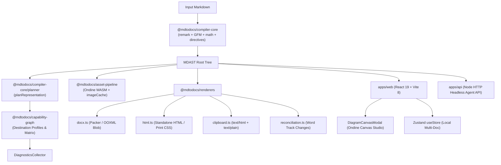
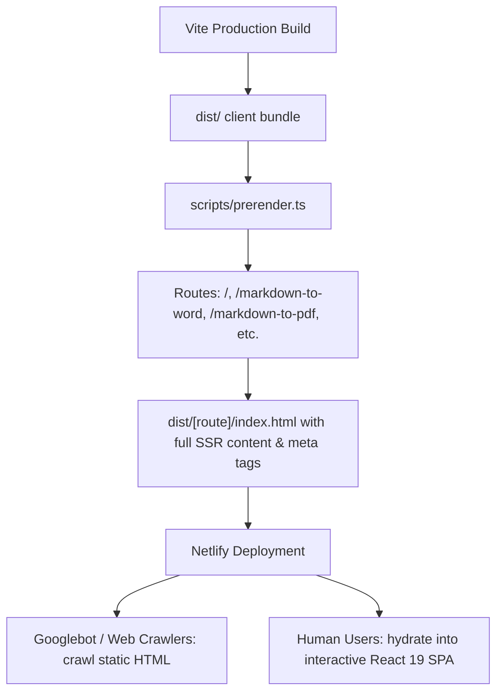
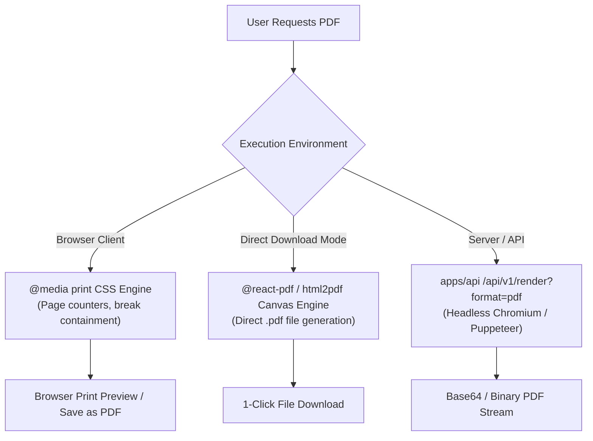
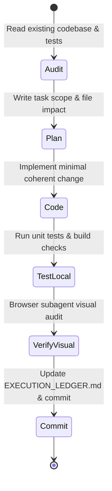

# MDToDocs v2: Master Implementation Plan & Antigravity Execution Playbook

**Version:** 2.0  
**Date:** 2026-10-23  
**Status:** Canonical Master Plan  
**Target Repository:** `devank2204/md-to-docs`  
**Product URL:** [mdtodocs.com](https://mdtodocs.com)  
**Governing Documents:**
- [docs/new-requirements-v2.md](file:///d:/mdtodocs/md-to-docs/docs/new-requirements-v2.md)
- [docs/EXECUTION_LEDGER.md](file:///d:/mdtodocs/md-to-docs/docs/EXECUTION_LEDGER.md)
- [docs/00_CONTEXT_INDEX.md](file:///d:/mdtodocs/md-to-docs/docs/00_CONTEXT_INDEX.md)
- [docs/07_ARCHITECTURE.md](file:///d:/mdtodocs/md-to-docs/docs/07_ARCHITECTURE.md)

---

## 1. Executive Summary & Strategic North Star

### 1.1 The Core Mission
MDToDocs is the **dependable output layer for AI-generated technical documents**. In a world where LLMs (Claude Code, Cursor, ChatGPT, Codex) output specifications, architecture plans, research notes, and PRDs in Markdown, the friction is never writing the markdown—it is transforming that markdown into client-ready, stakeholder-grade Word (`.docx`), PDF, and Google Docs formats without breaking formatting, silently stripping tables, truncating code, or corrupting diagrams.

> **Product Promise:** *What you preview is what you can reliably export, with transparent preflight diagnostics when destination limitations prevent exact fidelity.*

### 1.2 Non-Negotiable Product Constitution
1. **Zero Sign-In for Core Conversion:** Instant utility. Paste markdown, preview, export.
2. **Unified Pipeline Architecture:** One compiler core, many destination adapters. Never fork parsing or AST logic across landing pages.
3. **Never Silently Drop Content:** Every unsupported construct (e.g. nested tables in Google Docs, raw KaTeX in Word) must either be safely polyfilled or surfaced with explicit pre-export warnings.
4. **Authentic SEO & Workflow Landing Pages:** Every landing page (`/markdown-to-word`, `/markdown-to-pdf`, etc.) must be crawlable, preconfigured with the corresponding intent, and backed by the real conversion engine. Zero keyword-stuffed doorway pages.
5. **No Fabricated Benchmarks or Claims:** Benchmark results, pass rates, and compatibility matrices must be backed by reproducible fixtures in CI.
6. **Privacy-First Local Execution:** Document content never leaves the user's browser during standard conversion. Remote asset fetching and analytics are strictly sandboxed and privacy-preserving.
7. **Restrained, High-Craft UX:** Built on quiet design principles (Linear/Perplexity aesthetic, Emil Kowalski design engineering). Micro-animations must serve user feedback, not decorative noise.

---

## 2. Baseline Architecture & Current Repository Reality

The repository has completed 31 discrete tasks documented in [docs/EXECUTION_LEDGER.md](file:///d:/mdtodocs/md-to-docs/docs/EXECUTION_LEDGER.md). A line-by-line audit establishes the exact current foundation:



### 2.1 Current Verified Capabilities
| Package / Subsystem | Current State | Verification Evidence |
|---|---|---|
| **Compiler Core** (`@mdtodocs/compiler-core`) | Parsing Markdown via Remark GFM, Math, Directives; Theme registry; Diagnostics collector. | 17/17 tests pass in `vitest`. |
| **Capability Graph** (`@mdtodocs/capability-graph`) | Evaluates nodes against 4 destinations (`word`, `google-docs`, `pdf`, `clipboard`). | `packages/capability-graph/src/index.ts` (319 lines). |
| **Asset Pipeline** (`@mdtodocs/asset-pipeline`) | Pure Rust/WASM Mermaid compilation via `wevm/ondine`; in-memory remote image caching; AbortSignal support. | Sub-millisecond diagram compile; concrete hex color inlining. |
| **Renderers** (`@mdtodocs/renderers`) | High-fidelity DOCX generation (`docx.ts`, 742 lines); Clipboard HTML (`clipboard.ts`); Table clipboard TSV/CSV (`tableClipboard.ts`); Word comment & track changes reconciliation. | All 17 fixtures pass in `packages/fidelity-lab`. |
| **Web App** (`apps/web`) | React 19 + Vite 8; Emil Kowalski restrained loading button; Diagram Canvas Studio modal; Piixpal companion; dark/light theme; multi-document tabs. | `npx pnpm --filter web build` builds cleanly in 11.4s. |
| **Headless API** (`apps/api`) | Node HTTP server with `/api/v1/health`, `/api/v1/validate`, `/api/v1/render`, `/api/v1/reconcile`. | Clean builds, tests pass. |
| **Fidelity Lab** (`packages/fidelity-lab`) | 17 curated golden fixtures (`001-core-headings` to `016-math-expressions`, plus mermaid assets). | `npx pnpm test` -> 17/17 PASS in isolated temp dir. |
| **Validation Tests** (`packages/validation`) | 17 test suites, 93 unit and integration tests. | `vitest run` -> 17 files, 93 passed in 33.1s. |

---

## 3. Gap Analysis: v2 Requirements vs. Repository Reality

| Area | v2 Requirements (PRD v2.0) | Current Codebase Reality | Exact Engineering Delta |
|---|---|---|---|
| **Routing & SEO** | Crawlable landing routes: `/markdown-to-word`, `/markdown-to-pdf`, `/markdown-to-google-docs`, `/markdown-to-html`, `/markdown-to-rich-text`. | Single-page SPA (`/`). Direct route access 404s on static host. No Netlify config. | Add client-side router + SSG/prerendering build step generating static HTML per route; add `netlify.toml`, `sitemap.xml`, `robots.txt`. |
| **PDF Pipeline** | Reliable PDF engineering with pagination, headers, multi-page tables, and transparent limitation reporting. | Relying on uncalibrated browser print (`window.print()`). CLI test suite explicitly skips PDF assertions. | Implement calibrated `@media print` CSS engine + direct client PDF export options + headless PDF validation fixture in Fidelity Lab. |
| **Preflight Diagnostics (Document Rescue)** | Deterministic pre-export diagnostics for table overflow, broken images, unquoted diagrams, and destination limitations with 1-click safe repairs. | `planRepresentation` logs internal diagnostics, but there is no dedicated pre-export rescue drawer or actionable repair workflow. | Create `DocumentRescue` engine with rule registry, confidence scores, AST mutators, and a sleek pre-export drawer in `apps/web`. |
| **AI Presets** | Structural document presets: AI PRD, Engineering Design, Research Report, Executive Brief. | Only typography themes (`modern`, `academic`, etc.) exist. No document structure presets. | Implement Preset registry modifying typography, layout, callouts, and destination options without altering markdown text. |
| **Mermaid Cluster** | Dedicated `/mermaid-to-svg` and `/mermaid-to-png` workflows with transparent background and resolution controls. | Ondine WASM engine works in preview, but there are no dedicated standalone conversion routes. | Build standalone utility views leveraging existing `DiagramCanvasModal` and `packages/asset-pipeline/src/mermaid.ts`. |
| **README Import** | Local README upload and safe GitHub repo Markdown fetcher with relative image resolution. | File upload exists in sidebar for `.md` text, but relative image references (`./docs/img.png`) break. | Add zip/folder local asset resolver and safe raw GitHub fetcher with rate limiting and URL proxying. |
| **Public Benchmark** | Reproducible public benchmark page (`/benchmark`) showing fixture inputs, outputs, and methodology. | Fidelity Lab runs locally and in CI, but results are not visible to users on the web. | Build interactive benchmark comparison page generated directly from `fidelity-lab` fixtures. |
| **Privacy Analytics** | Privacy-respecting telemetry tracking funnels, destinations, and export errors without transmitting markdown. | Zero analytics implemented. | Implement zero-cookie, zero-content-leak event dispatcher in `apps/web/src/utils/analytics.ts`. |

---

## 4. Phased Master Roadmap (Prompts 00 to 17)

```mermaid
gantt
    title MDToDocs v2 Execution Timeline
    dateFormat  YYYY-MM-DD
    section Phase A: Foundation Hardening
    Prompt 00: Recon & Execution Map       :done,    p00, 2026-10-24, 1d
    Prompt 01: Fidelity Regression Harness  :active,  p01, 2026-10-25, 2d
    Prompt 02: Responsive & Overflow Audit  :         p02, after p01, 2d
    Prompt 03: Capability Contract & Errors :         p03, after p02, 2d
    section Phase B: Acquisition Foundation
    Prompt 04: Technical SEO & Netlify SSR  :         p04, after p03, 3d
    Prompt 05: 5 Core Conversion Routes     :         p05, after p04, 3d
    Prompt 06: Privacy-First Analytics      :         p06, after p05, 1d
    section Phase C: AI-Native Workflows
    Prompt 07: AI Document Presets          :         p07, after p06, 2d
    Prompt 08: Reliable PDF Engineering     :         p08, after p07, 3d
    Prompt 09: Document Rescue MVP          :         p09, after p08, 2d
    section Phase D: Distribution & Benchmarks
    Prompt 10: Mermaid Utility Cluster      :         p10, after p09, 2d
    Prompt 11: README & GitHub Asset Import :         p11, after p10, 2d
    Prompt 12: Public Fidelity Benchmark    :         p12, after p11, 2d
    Prompt 13: Launch Quality Audit         :         p13, after p12, 2d
    section Phase E: Conditional Expansion
    Prompt 14: Validated Template Gallery   :         p14, after p13, 2d
    Prompt 15: Headless CLI & MCP Interface :         p15, after p14, 3d
    Prompt 16: Evidence-Based SEO Refinement:         p16, after p15, 2d
    Prompt 17: Production Hardening & Sandbox:        p17, after p16, 2d
```

---

## 5. Detailed Iteration Blueprints (Prompt-by-Prompt)

### Phase A: Foundation Hardening (Days 1–7)

#### Prompt 00: Repository Reconnaissance & Master Execution Map
* **Objective:** Audit the live repository, reconcile existing codebase with `docs/new-requirements-v2.md`, and generate `docs/EXECUTION_MAP.md`.
* **Scope & Files Changed:**
  - Create `docs/EXECUTION_MAP.md` documenting verified vs partial vs absent components.
  - Document all baseline test commands and exact pass rates.
  - Maintain strict freeze on production runtime code during this iteration.
* **Acceptance Criteria:**
  - `docs/EXECUTION_MAP.md` is committed with zero speculative claims.
  - Baseline commands verified: `pnpm test` (17/17), `pnpm --filter @mdtodocs/validation test` (93/93), `pnpm --filter web build` (PASS).

#### Prompt 01: Fidelity Regression System & Destination Assertions
* **Objective:** Expand `packages/fidelity-lab` and `packages/validation` into a destination-aware regression harness.
* **Key Architecture Decisions:**
  - Add structural XML schema validation for DOCX (verifying table cell formatting, w:cantSplit, w:tblHeader).
  - Add clipboard HTML contract checks: verify `text/html` contains inlined table borders and inline math formulas.
  - Wire GitHub Actions CI in `.github/workflows/ci.yml` running unit tests, fidelity fixtures, and build verification.
* **Files Impacted:**
  - `packages/fidelity-lab/src/runner.ts` (Add destination-specific assertion runners for clipboard and HTML).
  - `packages/fidelity-lab/fixtures/*` (Add edge fixtures: 60-col table, deeply nested lists, malformed math).
  - `.github/workflows/ci.yml` (New CI workflow running `pnpm test`, `pnpm --filter @mdtodocs/validation test`, `pnpm --filter web build`).
* **Verification:** CI workflow passes locally and in remote test runner; regressions fail with actionable diffs.

#### Prompt 02: Overflow & Responsive Quality (320px to 1440px)
* **Objective:** Audit and eliminate all horizontal viewport overflow across 320px, 375px, 768px, 1280px, and 1440px viewports.
* **Key Architecture Decisions:**
  - Tables: Enforce `overflow-x: auto; max-width: 100%; display: block;` inside document preview wrappers while keeping table cells readable.
  - Code blocks: Horizontal scrolling contained strictly within `<pre>` containers with persistent copy buttons.
  - Canvas & Modals: Ensure `DiagramCanvasModal` and `TemplateGalleryModal` fit on small screens with scroll locking.
  - Touch targets: Mobile controls >= 44x44px; export menus must not clip outside the screen.
* **Files Impacted:**
  - `apps/web/src/index.css` (Responsive typography, table scroll containment).
  - `apps/web/src/components/DocumentPreview.tsx` (Table and pre wrapper styling).
  - `apps/web/src/components/Header.tsx` (Mobile responsive layout, collapsed action sheet).
  - `apps/web/src/components/WorkspaceSidebar.tsx` (Mobile drawer overlay).
* **Verification:** Browser subagent verifies 320px, 375px, 768px, 1280px, 1440px viewports with zero `window.scrollX` overflow.

#### Prompt 03: Destination Capability Contract & Structured Warning Model
* **Objective:** Formalize `@mdtodocs/capability-graph` and `@mdtodocs/compiler-core/diagnostics` into a typed, actionable warning model.
* **Key Architecture Decisions:**
  - Introduce typed `DocumentDiagnostic`:
    ```typescript
    export interface DocumentDiagnostic {
      id: string;
      ruleId: string;
      severity: 'error' | 'warning' | 'info';
      destination: DestinationType;
      message: string;
      nodeType?: string;
      position?: { line: number; column: number };
      fixAction?: {
        label: string;
        description: string;
        autoFixable: boolean;
        apply: (tree: Root) => void;
      };
    }
    ```
  - Integrate unobtrusive preflight indicator in `Header.tsx`: an issue badge next to the destination selector (`"1 warning for Word"`) that opens a clean flyout showing detected issues and safe fixes.
* **Files Impacted:**
  - `packages/capability-graph/src/index.ts` (Formalize rules and polyfill mappings).
  - `packages/compiler-core/src/diagnostics/index.ts` (Structured diagnostics with AST positions).
  - `packages/compiler-core/src/planner/index.ts` (Deterministic rule evaluation).
  - `apps/web/src/components/Header.tsx` (Pre-export warning badge and flyout).
* **Verification:** Unit tests proving wide tables trigger warnings for Word/PDF, and 1-click linearization resolves the warning.

---

### Phase B: Acquisition Foundation (Days 8–14)

#### Prompt 04: Technical SEO Foundation & Netlify SSR/Prerendering
* **Objective:** Implement crawlable static HTML for tool landing pages compatible with Netlify deployment.
* **Key Architecture Decisions:**
  - Build-time prerendering: Add a prerender script (`scripts/prerender.ts` using Vite SSR or Puppeteer/JSDOM) that outputs static HTML files into `apps/web/dist/` for each route:
    - `/index.html`
    - `/markdown-to-word/index.html`
    - `/markdown-to-pdf/index.html`
    - `/markdown-to-google-docs/index.html`
    - `/markdown-to-html/index.html`
    - `/markdown-to-rich-text/index.html`
  - Each static HTML file contains fully rendered H1, meta title, canonical link, Open Graph tags, JSON-LD structured data (`SoftwareApplication`), and intent-specific explanation text.
  - Netlify Configuration: Create `netlify.toml` with caching headers, security headers (CSP, HSTS, X-Frame-Options), and SPA fallback rules.
  - Create `sitemap.xml` and `robots.txt` in `apps/web/public/`.
* **Files Impacted:**
  - `netlify.toml` (Netlify build, headers, redirects).
  - `apps/web/public/robots.txt` & `apps/web/public/sitemap.xml`.
  - `apps/web/scripts/prerender.ts` (Static HTML generation script).
  - `apps/web/package.json` (Wire prerender into `build` script).
* **Verification:** Curl / browser verification with JavaScript disabled shows complete, readable HTML with correct status codes, meta tags, and H1s.

#### Prompt 05: Five Core Conversion Landing Pages
* **Objective:** Implement functional, intent-tailored routes for the 5 primary conversion use cases on ONE shared engine.
* **Route Specifications:**
  1. `/markdown-to-word`: Preselects `word` (`.docx`), pre-loads technical spec sample, displays Word styling capabilities (table borders, headers, track changes).
  2. `/markdown-to-pdf`: Preselects `pdf`, pre-loads report sample, highlights page breaks and print typography rules.
  3. `/markdown-to-google-docs`: Preselects `google-docs`, pre-loads PRD sample, provides paste guidance and rich-text tips.
  4. `/markdown-to-html`: Preselects `html`, pre-loads developer documentation sample, shows semantic HTML tags and styling.
  5. `/markdown-to-rich-text`: Preselects `clipboard`, pre-loads multi-table sample, guides table copy to Excel/Sheets.
* **Key Architecture Decisions:**
  - Lightweight routing in `apps/web`: Use standard HTML5 History API (`window.location.pathname`) to determine active route and preconfigure Zustand store state on initial load.
  - Intent landing section: When visiting a landing route, the top or bottom of the page includes concise, original explanatory content, feature matrix, and FAQ accordion without obstructing the instant-paste editor.
* **Files Impacted:**
  - `apps/web/src/routes/landingData.ts` (Intent copy, default markdown samples, FAQs).
  - `apps/web/src/components/LandingPageContent.tsx` (Original SEO explanation component).
  - `apps/web/src/App.tsx` (Route matching and pre-configuration).
* **Verification:** Direct URL navigation to each route hydrates correctly, pre-selects correct destination, and renders original content.

#### Prompt 06: Privacy-First Product Analytics
* **Objective:** Implement zero-cookie, privacy-respecting product analytics tracking conversion funnels.
* **Event Telemetry Contract:**
  - `page_view`: `{ path: string, referrer: string }`
  - `editor_action`: `{ action: 'paste' | 'sample' | 'type' | 'clear', docLengthBucket: '<500' | '500-2k' | '2k-10k' | '>10k' }`
  - `destination_change`: `{ from: string, to: string }`
  - `export_attempt`: `{ destination: string, format: string, hasWarnings: boolean }`
  - `export_success`: `{ destination: string, format: string, durationMs: number }`
  - `export_failure`: `{ destination: string, format: string, errorType: string }`
  - `preset_change`: `{ presetId: string }`
  - `canvas_studio_open`: `{ diagramType: string }`
* **Privacy Guarantees:**
  - Never capture, transmit, or log document text, headers, code content, or file names.
  - Lengths are strictly bucketed; user IDs are anonymous daily hashes or disabled.
  - Gracefully handles blocked network requests when ad-blockers are active.
* **Files Impacted:**
  - `apps/web/src/utils/analytics.ts` (Telemetry client with Plausible/Umami/custom adapter).
  - `apps/web/src/components/Header.tsx`, `apps/web/src/components/Workspace.tsx` (Event instrumentation).
* **Verification:** Unit tests assert event payload schemas; zero raw markdown strings are ever present in payloads.

---

### Phase C: AI-Native Workflows (Days 15–21)

#### Prompt 07: AI-Generated Document Presets
* **Objective:** Provide structural output presets tailored for AI document workflows without destructive text rewrites.
* **Preset Profiles:**
  1. **AI PRD & Specification (`ai-prd`):** Modern clean typography, accent color on section headers, boxed callouts for Requirements, table alternating fills, keep-with-next pagination.
  2. **Technical Architecture Spec (`tech-arch`):** Monospace font calibration, high-contrast code blocks, full-bleed Ondine diagrams, expanded table widths.
  3. **Research & Analysis Report (`research-report`):** Serif body typography (Times New Roman / Georgia), centered blockquotes, formal academic table borders, KaTeX display math formatting.
  4. **Executive & Client Deliverable (`executive-brief`):** Elegant navy/zinc accents, generous line heights, summary callout box, minimalist tables, subtle footer pagination.
* **Key Architecture Decisions:**
  - Presets live in `@mdtodocs/compiler-core/src/presets` as typed configurations.
  - Presets influence the Theme typography, spacing, and AST rendering styles, but NEVER modify the source Markdown string.
* **Files Impacted:**
  - `packages/compiler-core/src/presets/index.ts` (Preset definitions & registry).
  - `apps/web/src/store/index.ts` (Active preset state).
  - `apps/web/src/components/Header.tsx` (Preset selector pill).
* **Verification:** Exporting the same markdown across all 4 presets produces visibly differentiated DOCX and HTML styling without data loss.

#### Prompt 08: Reliable PDF Engineering
* **Objective:** Build a dependable, high-fidelity PDF export workflow with strict pagination control.
* **Key Architecture Decisions:**
  - **Calibrated Print Engine (`@media print`):**
    - `@page { size: letter; margin: 1in; }`
    - `table, pre, blockquote, .mermaid-container { break-inside: avoid; page-break-inside: avoid; }`
    - `h1, h2, h3 { break-after: avoid; page-break-after: avoid; }`
    - Running headers and footers with CSS `counter(page)` and `counter(pages)`.
  - **Direct Client PDF Download:**
    - Support 1-click direct download via client-side print trigger or headless rendering in `apps/api` (`/api/v1/render?format=pdf`) using headless Chromium when running in server environments.
  - **Limitation Transparency:**
    - If a document contains ultra-wide tables (>10 columns), render an explicit print preview advisory showing expected column wraps.
* **Files Impacted:**
  - `apps/web/src/index.css` (Comprehensive `@media print` rules).
  - `apps/web/src/components/DocumentPreview.tsx` (Print stylesheet classes, page-break indicators).
  - `packages/renderers/src/html.ts` (Full-document HTML export with embedded print styles).
* **Verification:** Multi-page documents print without orphan headings, split code blocks, or clipped diagrams.

#### Prompt 09: Document Rescue MVP (Preflight Diagnostics & Auto-Repair)
* **Objective:** Build a deterministic pre-export diagnostic engine that detects layout risks and offers 1-click safe repairs.
* **Rules Catalog:**
  | Rule ID | Trigger Condition | Severity | Safe Auto-Repair Action |
  |---|---|---|---|
  | `TABLE_OVERFLOW` | Table columns > 6 on Word/PDF | Warning | Linearize table into key-value list representation. |
  | `MERMAID_SYNTAX` | Unquoted brackets or unclosed subgraph | Error | Quote node labels `["..."]` and close subgraphs via `autoFixMermaidCode`. |
  | `IMAGE_OFFLINE` | Remote image URL returns 404 or fails | Warning | Replace image with descriptive link fallback. |
  | `HEADING_ORPHAN` | Heading at bottom of section with no content | Info | Clean trailing orphan headings. |
  | `MATH_RAW_KATEX` | KaTeX display equation exported to Word | Info | Polyfill into high-res MathML / embedded formula. |
* **UI Integration:**
  - Floating status pill in preview: `"✨ Document Ready"` (Green) vs `"⚠️ 2 Suggestions"` (Amber).
  - Clicking opens a slide-over panel: "Document Rescue". Each issue displays the line number, description, and an `[Apply Fix]` button that atomically patches the editor markdown.
* **Files Impacted:**
  - `packages/compiler-core/src/diagnostics/rules.ts` (Rule registry).
  - `apps/web/src/components/DocumentRescuePanel.tsx` (Slide-over rescue drawer).
  - `apps/web/src/store/index.ts` (Store diagnostics state).
* **Verification:** Unit tests verify each diagnostic fires accurately on faulty markdown and that auto-fixes produce valid ASTs.

---

### Phase D: Developer Distribution (Days 22–30)

#### Prompt 10: Mermaid Utility Cluster (`/mermaid-to-svg`, `/mermaid-to-png`)
* **Objective:** Expand the Ondine WASM engine into dedicated developer utility workflows.
* **Features:**
  - Dedicated routes: `/mermaid-to-svg`, `/mermaid-to-png`.
  - Standalone instant editor with immediate preview.
  - Background selector: Transparent vs Solid White vs Dark (`#0f172a`).
  - Resolution selector for PNG: 1x, 2x (Retina), 4x (Print).
  - Instant actions: `[Download SVG]`, `[Download PNG]`, `[Copy SVG Code]`, `[Copy Image to Clipboard]`.
* **Files Impacted:**
  - `apps/web/src/routes/MermaidUtilityPage.tsx` (Standalone utility view).
  - `packages/asset-pipeline/src/mermaid.ts` (Resolution scaling and background color support).
* **Verification:** Exported SVGs and PNGs render crisply in Figma, Illustrator, and Word with exact dimensions.

#### Prompt 11: README and GitHub Markdown Workflow
* **Objective:** Support README conversion to PDF/Word from pasted text, local file/zip upload, or GitHub URL.
* **Features:**
  - Local Upload with Assets: User can upload a README `.md` alongside images or a `.zip` bundle. An in-browser asset resolver matches relative image links (`./assets/demo.png`) to in-memory blobs.
  - GitHub URL Import: User pastes a GitHub repo URL (e.g., `https://github.com/facebook/react`). The app fetches the raw README via safe proxy, resolves absolute GitHub raw image URLs, and pre-fills the editor.
  - Privacy & Security: Zero credential prompts. Rate limiting enforced.
* **Files Impacted:**
  - `apps/web/src/utils/githubFetcher.ts` (Safe raw README fetcher and image URL rewriter).
  - `apps/web/src/utils/localAssetResolver.ts` (Zip / multi-file folder reader).
  - `apps/web/src/components/WorkspaceSidebar.tsx` (GitHub import action).
* **Verification:** Importing a popular GitHub README converts with all images intact and exported to DOCX/PDF.

#### Prompt 12: Public Fidelity Benchmark Page (`/benchmark`)
* **Objective:** Create a public, reproducible benchmark comparison page backed by real fixture data.
* **Page Contents:**
  - Overview of the 16 core fidelity fixtures (`headings`, `tables`, `nested lists`, `mermaid`, `math`, `callouts`).
  - Visual side-by-side: Markdown Input vs MDToDocs Output vs Standard Converter Output (e.g. Pandoc / Google Docs native import).
  - Concrete pass/fail metrics based on automated tests.
  - Honest known limitations section: What Word can and cannot render natively.
  - Reproducibility guide: How to clone repo and run `pnpm test` locally.
* **Files Impacted:**
  - `apps/web/src/routes/BenchmarkPage.tsx` (Public benchmark UI).
  - `packages/fidelity-lab/src/benchmarkData.ts` (Exports test metrics to JSON for web display).
* **Verification:** Benchmark page renders accurately with zero fabricated scores.

#### Prompt 13: Launch Quality Audit & Release Gate
* **Objective:** Perform a rigorous, multi-vector launch audit across the entire application before declaring production readiness.
* **Audit Checklist:**
  - [ ] **Lighthouse Performance:** Score >= 95 on Desktop, >= 90 on Mobile.
  - [ ] **Accessibility (a11y):** Zero Axe / Lighthouse critical accessibility violations; visible keyboard focus on all buttons.
  - [ ] **Mobile Viewports:** Zero horizontal overflow on 320px, 375px, 768px.
  - [ ] **SEO & Crawlability:** All 5 core routes return complete HTML with JS disabled; sitemap valid; robots.txt valid.
  - [ ] **Security:** DOMPurify sanitizes all HTML; links have `rel="noopener noreferrer"`; no secret leaks.
  - [ ] **Test Coverage:** All 93 validation tests pass; all 17 fidelity fixtures pass; web build succeeds.
* **Deliverable:** `docs/RELEASE_AUDIT_REPORT.md` with timestamped evidence.

---

### Phase E: Conditional Expansion (Days 31–90)

#### Prompt 14: Validated Template Gallery
* **Condition:** Trigger only if search demand and repeat usage warrant template entry points.
* **Scope:** 4 high-demand templates (AI PRD, Architecture Decision Record, Engineering Design Document, Research Summary) with pre-filled sample markdown and instant export presets.

#### Prompt 15: Headless CLI & MCP Interface (`@mdtodocs/cli`, `@mdtodocs/mcp`)
* **Condition:** Trigger once core compiler APIs and fidelity fixtures achieve 100% stability.
* **Scope:** Reusable Node CLI (`npx mdtodocs input.md -o output.docx`) and Model Context Protocol (MCP) tool allowing Claude Desktop and Cursor to programmatically convert documents.

#### Prompt 16: SEO Refinement from Real Search Console Evidence
* **Condition:** Trigger 30 days after initial sitemap indexing.
* **Scope:** Audit real Google Search Console query data, identify high-impression/low-CTR opportunities, refine titles/descriptions, and eliminate keyword cannibalization.

#### Prompt 17: Production Hardening & Sandbox Security
* **Condition:** Trigger before enterprise scale.
* **Scope:** Bound document compilation memory limits (reject files > 15MB), add parsing timeout guards (5000ms), and sanitize SVG XML against prototype pollution and entity expansion attacks.

---

## 6. Technical Architecture Deep-Dives

### 6.1 Technical SEO & Netlify Prerendering Architecture
Because `apps/web` is a Vite SPA, search engine bots that execute minimal JavaScript need static HTML.



* **Implementation:** `apps/web/scripts/prerender.ts` renders each landing page using the existing Remark parser and component templates, producing standalone HTML files containing the target H1, metadata, structured schema, and a functional editor.
* **Netlify Headers:** `netlify.toml` configures aggressive caching for `/assets/*` (immutable, 1 year) and no-cache for `/index.html` and sitemaps.

### 6.2 Dual-Engine PDF Architecture



### 6.3 Document Rescue Engine Architecture

```typescript
// packages/compiler-core/src/diagnostics/rescue.ts
export interface RescueRule {
  id: string;
  name: string;
  severity: 'error' | 'warning' | 'info';
  check: (tree: Root, destination: DestinationType) => DocumentDiagnostic[];
  fix?: (tree: Root) => Root;
}

export class DocumentRescueEngine {
  private rules: RescueRule[] = [];

  registerRule(rule: RescueRule) {
    this.rules.push(rule);
  }

  analyze(tree: Root, destination: DestinationType): DocumentDiagnostic[] {
    return this.rules.flatMap(rule => rule.check(tree, destination));
  }

  applyFix(tree: Root, ruleId: string): Root {
    const rule = this.rules.find(r => r.id === ruleId);
    if (!rule || !rule.fix) throw new Error(`No fix registered for ${ruleId}`);
    return rule.fix(tree);
  }
}
```

---

## 7. Operational Protocol & Definition of Done

Every task executed under this Master Plan must strictly follow the established engineering sequence:



### Non-Negotiable Acceptance Gate
Before any task is marked complete in `EXECUTION_LEDGER.md`:
1. **Unit & Integration Tests:** `npx pnpm --filter @mdtodocs/validation test` must pass (100% pass rate).
2. **Fidelity Fixtures:** `npx pnpm test` (`packages/fidelity-lab`) must pass with zero fixture regressions.
3. **Production Build:** `npx pnpm --filter web build` must complete with zero TypeScript or Vite errors.
4. **Visual Audit:** Browser verification screenshot captured proving no clipped UI or broken layout.
5. **Ledger Update:** Detailed entry appended to `docs/EXECUTION_LEDGER.md` documenting Scope, Files Changed, Exact Test Results, and Acceptance Criteria checked.

---

## 8. Immediate Next Action

We are ready to begin execution starting at **Phase A: Foundation Hardening**.
- **First Step:** Initialize `docs/EXECUTION_MAP.md` (Prompt 00) to lock the canonical architecture map and establish the automated CI baseline.
- **Proceeding Directive:** Proceed systematically, prompt by prompt, verifying each gate with deterministic test evidence.
