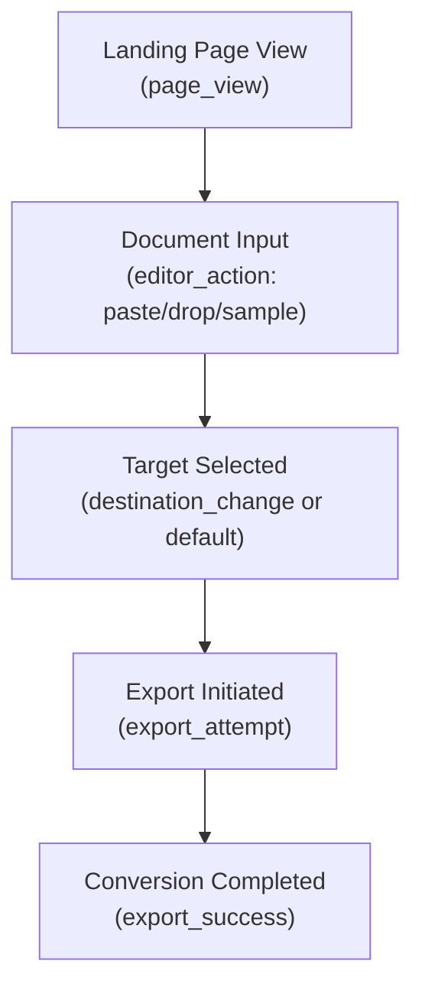

# Privacy-First Product Analytics & Telemetry Contract

This document outlines the privacy guarantees, telemetry schemas, consent architecture, fault tolerance, and dashboard specifications for **mdtodocs** product analytics.

---

## 1. Core Privacy Guarantees

mdtodocs is an in-browser document compiler designed for sensitive engineering specifications, financial reports, and proprietary documentation. The telemetry architecture adheres to four uncompromising privacy rules:

1. **Zero Document Content Transmission:**
   - Markdown body text, section headers, equation formulas, code lines, and raw file names are **never captured, stored, or transmitted**.
   - Input lengths are strictly bucketed into coarse bands (`<500`, `500-2k`, `2k-10k`, `>10k`).
   - Any property containing formatting characters (`#`, `\n`, `|`, `$$`, `\``) or exceeding 100 characters is rejected by the sanitizer and replaced with `[REDACTED]`.

2. **Zero Cookie / Persistent Tracker Footprint:**
   - No tracking cookies, third-party advertising beacons, fingerprinting canvas scripts, or cross-site identifier tags are used.
   - Repeat usage is measured strictly via an anonymous local increment counter in browser `localStorage` (`mdtodocs_export_count`) bucketed as `1`, `2-5`, `6-20`, or `>20`.

3. **Ad-Blocker & Network Rejection Resilience:**
   - Telemetry uses standard fire-and-forget mechanisms (`navigator.sendBeacon`) wrapped in defensive try/catch handlers.
   - If ad-blockers (e.g. uBlock Origin, Brave Shields) or strict corporate firewalls block analytics calls, the application functions with 100% feature completeness and zero errors.

4. **100% Client-Side Processing:**
   - All document conversion, AST transformation, and rendering occurs locally in the user's browser sandbox.

---

## 2. Event Telemetry Contract

All events are strictly typed and conform to the following contract in `apps/web/src/utils/analytics.ts`:

### 2.1 `page_view`
Triggered upon landing route navigation and client-side history navigation (`popstate`).
```json
{
  "event": "page_view",
  "properties": {
    "path": "/markdown-to-word",
    "referrer": "https://www.google.com/"
  },
  "timestamp": 1792880000000
}
```
*Deduplication rule:* Consecutive calls with the identical `path` are debounced.

---

### 2.2 `editor_action`
Tracks user interaction with the editor and terminal input without leaking any content.
```json
{
  "event": "editor_action",
  "properties": {
    "action": "paste",
    "docLengthBucket": "2k-10k"
  },
  "timestamp": 1792880015000
}
```
*Allowed actions:* `'paste' | 'sample' | 'type' | 'clear' | 'drop'`  
*Bands:* `'<500' | '500-2k' | '2k-10k' | '>10k'`  
*Rate limiting rule:* Typing keystrokes are debounced to at most once per 15 seconds.

---

### 2.3 `destination_change`
Tracks when a user switches between target outputs in the segmented control.
```json
{
  "event": "destination_change",
  "properties": {
    "from": "google-docs",
    "to": "word"
  },
  "timestamp": 1792880020000
}
```

---

### 2.4 `export_attempt`
Fires when the primary action button is clicked before the export operation begins.
```json
{
  "event": "export_attempt",
  "properties": {
    "destination": "word",
    "format": "docx",
    "hasWarnings": false
  },
  "timestamp": 1792880030000
}
```

---

### 2.5 `export_success`
Fires when the export pipeline finishes successfully (blob generated or clipboard written).
```json
{
  "event": "export_success",
  "properties": {
    "destination": "word",
    "format": "docx",
    "durationMs": 42
  },
  "timestamp": 1792880030042
}
```

---

### 2.6 `export_failure`
Fires if document generation encounters an error or browser permission issue.
```json
{
  "event": "export_failure",
  "properties": {
    "destination": "clipboard",
    "format": "clipboard_html",
    "errorType": "clipboard_permission_denied"
  },
  "timestamp": 1792880035000
}
```

---

### 2.7 `repeat_usage`
Fires alongside successful exports to monitor retention without recording PII.
```json
{
  "event": "repeat_usage",
  "properties": {
    "exportCountBucket": "2-5"
  },
  "timestamp": 1792880030043
}
```
*Bands:* `'1' | '2-5' | '6-20' | '>20'`

---

## 3. Regulatory Alignment & Consent Architecture

| Framework | Status | Justification |
| :--- | :---: | :--- |
| **GDPR (EU)** | Compliant | Zero personal data (no IP addresses, no pseudonymous user IDs, no cookies). Legitimate interest for anonymous aggregated telemetry. Cookie banner **not required**. |
| **ePrivacy Directive** | Compliant | No device storage tracking or non-essential cookies. `localStorage` is used solely for essential document drafts and coarse numeric buckets. |
| **CCPA / CPRA (California)** | Compliant | Zero personal information collected, sold, or shared. |

---

## 4. Measurement Limitations & Honest Caveats

1. **Ad-Blocker Under-Reporting:**
   - 25%–40% of technical developers use content blockers that drop outgoing beacon requests. Real export totals will be proportionally higher than raw beacon counts.
2. **Coarse Length Granularity:**
   - Exact token counts or character totals are unavailable by design to maintain zero content leakage.
3. **Session Stitching Omission:**
   - Because no session cookies or persistent hardware IDs exist, user journeys across multiple days appear as independent visits.

---

## 5. Conversion Funnel Dashboard Specification

A self-hosted metrics dashboard (e.g. Plausible, Umami, or ClickHouse) calculates the following core funnel stages:



### Key Performance Indicators (KPIs):
- **Landing-to-Input Rate:** `COUNT(editor_action) / COUNT(page_view)` (Target: > 45%)
- **Input-to-Export Rate:** `COUNT(export_attempt) / COUNT(editor_action)` (Target: > 70%)
- **Export Reliability:** `COUNT(export_success) / COUNT(export_attempt)` (Target: > 99.5%)
- **Destination Distribution:** Breakdown of exports across `word`, `google-docs`, `pdf`, `html`, and `clipboard`.
- **Warning Correlation:** Conversion success rate when `hasWarnings === true` vs `hasWarnings === false`.
